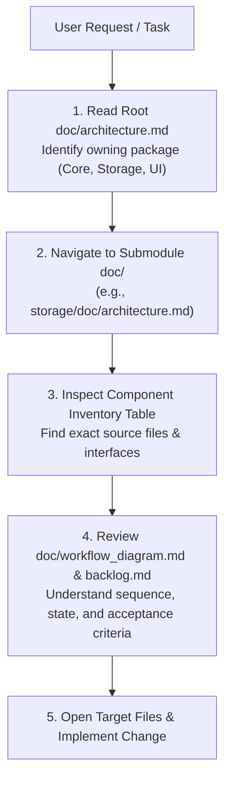

# Agent Operating Guidelines: Shortcut Studio

> **Target Audience**: AI Agents (Antigravity, Claude, ChatGPT, Cursor, etc.) and automated code contributors working within this repository.  
> **Repository**: `c:\Users\max99\Desktop\myProgram\ShortcutStudio`  
> **Language & Frameworks**: Python 3.11+, PyQt6, SQLite3, Windows COM API (`ctypes.windll.ole32`).

---

## 1. System Mission & Architecture Overview

**Shortcut Studio** is an offline Windows desktop utility that organizes and automates shortcut creation, verification, and maintenance for application libraries. It scans source directories, disambiguates executable targets, creates native `.lnk` shortcuts using the Windows COM ShellLink API, and tracks library metadata in a local SQLite database (`%LOCALAPPDATA%\ShortcutStudio\shortcut_studio.db`).

The repository is modularized into distinct, single-responsibility layers with backwards-compatible facades at the root:

```
ShortcutStudio/
├── AGENTS.md                                # This operating manual
├── README.md                                # User-facing setup & usage
├── About.txt                                # Product vision & roadmap (MAINTAINED MANUALLY BY REPO OWNER)
├── requirements.txt                         # Runtime dependencies
├── run.py                                   # Entrypoint script
│
├── templates/doc/                           # Master templates for all documentation
│   ├── architecture.md
│   ├── workflow_diagram.md
│   ├── changelog.md
│   └── backlog.md
│
├── shortcut_studio/                         # Primary application package
│   ├── __init__.py                          # Version and core type re-exports
│   ├── models.py                            # Shared dataclasses and enums
│   ├── scanner.py                           # Filesystem inspection utilities
│   ├── app.py                               # Facade: re-exports MainWindow, main()
│   ├── database.py                          # Facade: re-exports Database, DEFAULT_SETTINGS
│   ├── shortcuts.py                         # Facade: re-exports COM link creation functions
│   ├── worker.py                            # Facade: re-exports ScanWorker
│   │
│   ├── core/                                # Concurrency & Windows platform integration
│   │   ├── shell_link.py                    # Windows COM ctypes interface & path sanitization
│   │   └── worker.py                        # ScanWorker QThread engine & synchronization
│   │
│   ├── storage/                             # Persistence & database layer
│   │   ├── connection.py                    # SQLite connection provider & path normalization
│   │   ├── schema.py                        # DDL table definitions & schema migrations
│   │   ├── repository.py                    # PairRepository, RunRepository, SettingsRepository
│   │   ├── backup.py                        # JSON backup import/export serializer
│   │   └── database.py                      # Unified Database facade wrapping repositories
│   │
│   ├── ui/                                  # Presentation layer (PyQt6)
│   │   ├── theme.py                         # Colors & QSS dark styling
│   │   ├── window.py                        # MainWindow orchestrator & page navigation
│   │   ├── components/                      # Reusable UI widgets (cards, folder rows, header)
│   │   └── pages/                           # 10 modular application pages
│   │
│   └── doc/                                 # Package-level documentation suite
│       ├── architecture.md
│       ├── workflow_diagram.md
│       ├── changelog.md
│       └── backlog.md
│
├── plan/                                    # Planning and task tracking
│   ├── TODO.md                              # Planned features & user stories
│   ├── FIX_TODO.md                          # UI & structural fixes
│   └── Finished/                            # Archived architectural plans
│
└── tests/                                   # Automated test suite
    └── test_core.py                         # Comprehensive unit & integration tests
```

---

## 2. The Golden Rule: Hierarchical Documentation (`doc/` in Every Code Folder)

### Mandatory Folder Structure Rule
> **Every single code folder in this repository—including submodules, subpackages, and nested component folders—MUST maintain its own dedicated `doc/` directory.**

```
<code_directory>/
├── __init__.py (or source files)
└── doc/
    ├── architecture.md      # Architecture, component boundaries, and invariants
    ├── workflow_diagram.md  # Mermaid diagrams (class, sequence, state, ERD)
    ├── changelog.md         # Historical log of all changes in this module
    └── backlog.md           # Implementation-ready tasks & tech debt for this module
```

### Hierarchy & Scoping
Documentation is scoped hierarchically to avoid monolithic, unmaintainable documents:
1. **Root Package (`shortcut_studio/doc/`)**: High-level system architecture, cross-package coordination, public interfaces, macro state flows, and project-wide changelog/backlog.
2. **Subpackage Level (`core/doc/`, `storage/doc/`, `ui/doc/`)**: Domain-specific architecture, internal contracts, package invariants, detailed class diagrams, and localized changelogs.
3. **Sub-module Level (`ui/components/doc/`, `ui/pages/doc/`)**: Granular UI component hierarchies, individual page state machines, widget styling contracts.
4. **Test Suite Level (`tests/doc/`)**: Testing architecture, mock strategies, headless testing guidelines.

> [!IMPORTANT]
> If you create a **new code folder or submodule**, you **MUST** immediately create its `doc/` folder populated from `templates/doc/`. Creating the `doc/` folder itself must be recorded as an `[Added]` entry in that module's `changelog.md`.

---

## 3. How Templates Work & How to Use Them

The directory [`templates/doc/`](file:///c:/Users/max99/Desktop/myProgram/ShortcutStudio/templates/doc/) contains the authoritative master templates. Each template file defines the exact structure, rules, and prompts required for that document type.

### 3.1 Initializing a New `doc/` Directory from Templates

When adding documentation to a folder:
1. Copy the 4 template files from [`templates/doc/`](file:///c:/Users/max99/Desktop/myProgram/ShortcutStudio/templates/doc/) into the module's `doc/` folder:
   - `architecture.md`
   - `workflow_diagram.md`
   - `changelog.md`
   - `backlog.md`
2. Notice line 1 in every template:
   ```markdown
   (After first edit this file, delete the instruction)
   ```
   **Delete this instruction header line** after filling in the module's details.
3. Fill in the content scoped strictly to the code in that directory.
4. Log the initialization in `changelog.md` under `### Added`:
   ```markdown
   #### YYYY-MM-DD - Module Documentation Directory
   - Created module documentation directory (`doc/`) adhering to engineering templates.
   ```

---

### 3.2 Deep Dive: The 4 Documentation Types

#### 1. `architecture.md` (System & Module Architecture)
- **Source Template**: [`templates/doc/architecture.md`](file:///c:/Users/max99/Desktop/myProgram/ShortcutStudio/templates/doc/architecture.md)
- **Purpose**: Explains the system/module purpose, boundaries, components, data flows, and invariants.
- **Mandatory Requirements**:
  1. Base every statement on current code. **Never hallucinate** nonexistent classes, endpoints, or guarantees.
  2. Maintain a **Component Inventory Table** linking directly to source files using repository-relative links:
     ```markdown
     | Component | File Link | Responsibility | Key Interfaces |
     | :--- | :--- | :--- | :--- |
     | Storage Facade | [`database.py`](../database.py) | Manages SQLite connection & repos | `Database` |
     ```
  3. Explicitly state **Ownership & Boundaries**: which class owns state transitions, database tables, thread lifecycles.
  4. Document **Invariants & Safeguards** (e.g., target confinement, path normalization).

#### 2. `workflow_diagram.md` (Visual Architecture)
- **Source Template**: [`templates/doc/workflow_diagram.md`](file:///c:/Users/max99/Desktop/myProgram/ShortcutStudio/templates/doc/workflow_diagram.md)
- **Purpose**: Visualizes workflows, data relationships, and state transitions using Mermaid.
- **Mandatory Requirements**:
  1. **Class Diagram is Required** (`classDiagram`). Shows classes, attributes, methods, and relationships.
  2. Conditional diagrams where helpful:
     - `sequenceDiagram`: Request flows, worker threads, user dialog pauses.
     - `stateDiagram-v2`: Lifecycle transitions (e.g., folder scan result statuses).
     - `erDiagram`: SQLite database schemas, tables, and foreign key relationships.
  3. Diagram symbols, field names, and methods **must match source code exactly**.
  4. Every diagram must be accompanied by a clear, plain-language text explanation beneath it.

#### 3. `changelog.md` (Historical Log of Changes)
- **Source Template**: [`templates/doc/changelog.md`](file:///c:/Users/max99/Desktop/myProgram/ShortcutStudio/templates/doc/changelog.md)
- **Purpose**: Tracks user- and developer-facing modifications chronologically.
- **Mandatory Requirements**:
  1. Group changes under standard tags: `Added`, `Changed`, `Deprecated`, `Removed`, `Fixed`, `Security`.
  2. Every entry header **must** include the date in `YYYY-MM-DD` format:
     ```markdown
     ### Added

     #### 2026-10-18 - Feature Name
     - Summary of observable change or behavior.
     - Linked references to affected files.
     ```
  3. **Rule 10**: Creating a `doc/` folder is explicitly considered a change and must be recorded under `Added`.
  4. Include a `## Migration and Upgrade Notes` section if schema or operational changes occur (or explicitly state "No operator action required").

#### 4. `backlog.md` (Implementation-Ready Tasks & Tech Debt)
- **Source Template**: [`templates/doc/backlog.md`](file:///c:/Users/max99/Desktop/myProgram/ShortcutStudio/templates/doc/backlog.md)
- **Purpose**: Actionable backlog of pending work, known defects, and planned improvements.
- **Mandatory Requirements**:
  1. Organize by priority: `## High Priority`, `## Medium Priority`, `## Low Priority`.
  2. Use markdown checkboxes `- [ ]` for actionable tasks.
  3. Every backlog item must contain structured fields:
     - **Title**: Action-oriented summary.
     - **Problem or opportunity**: What is missing, broken, or needs optimization.
     - **Desired outcome**: Observable result defining completion.
     - **Scope**: Affected files and packages.
     - **Acceptance criteria**: Numbered, testable conditions.
     - **Dependencies and risks**: Rollback considerations, regressions to prevent.
     - **Verification**: Exact commands or unit tests to validate.
     - **Priority**: Urgency and rationale (Impact vs. Effort).
  4. Never leave `backlog.md` completely blank—if empty, state "No pending backlog items for this module."

---

## 4. How Agents Locate Target Files Fast (Zero-Guess Navigation)

When tasked with a bug fix, feature addition, or refactor, **DO NOT run broad grep searches or randomly explore source files**. Follow this fast 4-step navigation workflow:



### Navigation Cheat Sheet

| Need to change... | Look at this documentation first | Target Code Directory |
| :--- | :--- | :--- |
| **Windows COM link creation, `.lnk` parsing, worker thread** | [`shortcut_studio/core/doc/`](file:///c:/Users/max99/Desktop/myProgram/ShortcutStudio/shortcut_studio/core) | `shortcut_studio/core/` (`shell_link.py`, `worker.py`) |
| **SQLite tables, queries, migrations, JSON import/export** | [`shortcut_studio/storage/doc/`](file:///c:/Users/max99/Desktop/myProgram/ShortcutStudio/shortcut_studio/storage) | `shortcut_studio/storage/` (`connection.py`, `schema.py`, `repository.py`, `backup.py`, `database.py`) |
| **App pages, dialogs, button actions, window events** | [`shortcut_studio/ui/doc/`](file:///c:/Users/max99/Desktop/myProgram/ShortcutStudio/shortcut_studio/ui) | `shortcut_studio/ui/` (`window.py`, `pages/`) |
| **Widgets, cards, typography, layout components** | [`shortcut_studio/ui/doc/`](file:///c:/Users/max99/Desktop/myProgram/ShortcutStudio/shortcut_studio/ui) | `shortcut_studio/ui/components/` (`cards.py`, `folder_row.py`, `widgets.py`) |
| **Colors, dark mode theme, QSS stylesheets** | [`shortcut_studio/ui/doc/`](file:///c:/Users/max99/Desktop/myProgram/ShortcutStudio/shortcut_studio/ui) | `shortcut_studio/ui/theme.py` |
| **Data structures, enums, status types** | [`shortcut_studio/doc/architecture.md`](file:///c:/Users/max99/Desktop/myProgram/ShortcutStudio/shortcut_studio/doc/architecture.md) | `shortcut_studio/models.py` |
| **Directory scanning & `.exe` discovery** | [`shortcut_studio/doc/architecture.md`](file:///c:/Users/max99/Desktop/myProgram/ShortcutStudio/shortcut_studio/doc/architecture.md) | `shortcut_studio/scanner.py` |
| **Automated tests & test fixtures** | [`tests/`](file:///c:/Users/max99/Desktop/myProgram/ShortcutStudio/tests) | `tests/test_core.py` |

---

## 5. Agent Workflow: Step-by-Step SOP for Making Changes

Whenever an agent makes changes to this codebase, adhere strictly to this lifecycle:

### Step 1: Pre-Change Discovery
1. Check the local `doc/` of the affected module.
2. Review invariants and boundaries in `architecture.md`.
3. Check `backlog.md` to see if existing acceptance criteria apply.

### Step 2: Implementation & Backward Compatibility
1. **Preserve Root Facades**:
   - `shortcut_studio/app.py`, `shortcut_studio/database.py`, `shortcut_studio/shortcuts.py`, and `shortcut_studio/worker.py` are **facades**.
   - Any new or refactored public symbols must be re-exported by these facades to avoid breaking external imports, packaging specs, or existing tests.
2. **Adhere to Architectural Invariants**:
   - **Target Confinement Safeguard**: Never delete or overwrite files outside `target_folder`. Verify path resolution before any destructive action.
   - **Case-Insensitive Windows Paths**: All filesystem indexing must normalize paths with `os.path.normcase(os.path.abspath(path))` (`_path_key`).
   - **SQLite Foreign Keys**: Always ensure `PRAGMA foreign_keys = ON` on SQLite connections.
   - **Safe Thread Cancellation**: In GUI components, never kill worker threads abruptly; use `worker.cancel()` and bounded wait (`worker.wait(3000)`).
   - **Manual Owner Files**: Do **not** modify `About.txt` unless explicitly asked by the repo owner (it is the product roadmap).

### Step 3: Synchronize Documentation (Mandatory)
Every code edit requires matching documentation updates before completing the task:
- [ ] **Update `changelog.md`**: Add an entry under the appropriate tag (`Added`, `Changed`, `Fixed`) with the current date (`YYYY-MM-DD`).
- [ ] **Update `architecture.md`**: If components, interfaces, or invariants changed, reflect the changes in the text and inventory table.
- [ ] **Update `workflow_diagram.md`**: If class members, call sequences, or states changed, update the Mermaid diagram code.
- [ ] **Update `backlog.md`**: Mark completed items as checked `[x]`, or add any newly discovered technical debt or follow-up items.
- [ ] **Cross-Module Changes**: If a change alters high-level system behavior, update both the submodule `doc/` and the root package `shortcut_studio/doc/`.

### Step 4: Verification
Always run the test suite to ensure zero regressions:
```powershell
.venv\Scripts\python.exe -m unittest discover -s tests -v
```
Verify that import facades remain valid:
```powershell
.venv\Scripts\python.exe -c "from shortcut_studio.app import main, MainWindow; from shortcut_studio.database import Database; print('Facades valid')"
```

---

## 6. Checklist for AI Agents

Before declaring any coding task complete, verify this checklist:

```markdown
- [ ] Did you consult doc/ before making code changes to locate target files?
- [ ] Did you maintain single responsibility across modules (core vs storage vs ui)?
- [ ] Are all root facades (app.py, database.py, shortcuts.py, worker.py) preserved?
- [ ] Did you create a doc/ directory if a new code folder/module was introduced?
- [ ] Did you update the local doc/changelog.md with YYYY-MM-DD and proper tag?
- [ ] Did you update doc/architecture.md and doc/workflow_diagram.md if structure changed?
- [ ] Did you update doc/backlog.md to check off finished tasks?
- [ ] Did you run unit tests (.venv\Scripts\python.exe -m unittest discover -s tests -v) and confirm all pass?
```
