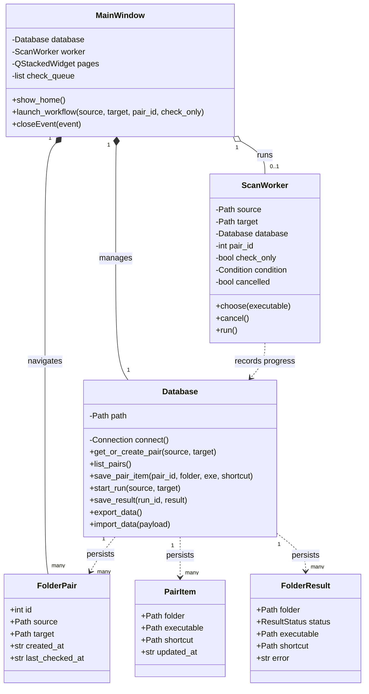
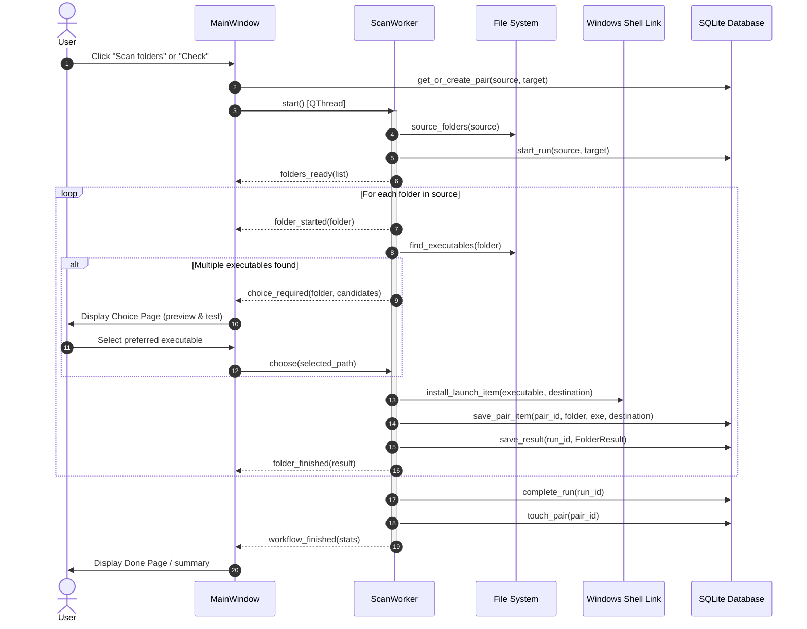
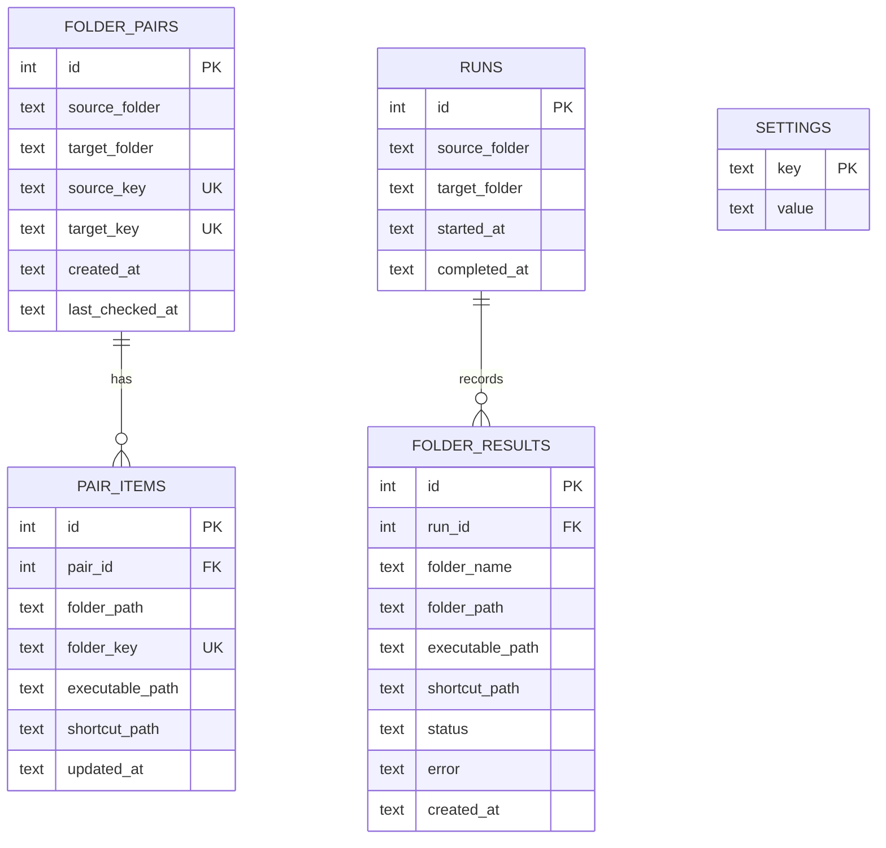
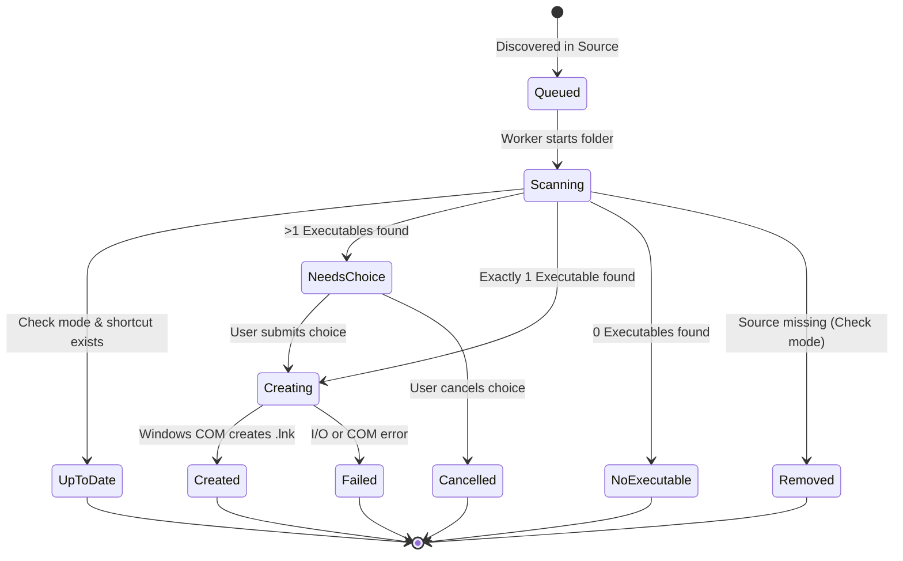

# Implementation Plan: Shortcut Studio Modularization & Architecture

**Target Project**: Shortcut Studio  
**Workspace**: `c:\Users\max99\Desktop\myProgram\ShortcutStudio`  
**Date**: 2026-10-17  
**Status**: Ready for Implementation  

---

## 1. Executive Summary & Goals

### 1.1 Objectives
1. **Modularize Oversized Modules**:
   - Refactor `shortcut_studio/app.py` (~1,287 lines) into dedicated presentation modules: styling/theme, reusable components, and distinct page views.
   - Refactor `shortcut_studio/database.py` (~474 lines) into a cohesive storage layer: connection manager, schema DDL & migrations, specialized repositories, and JSON backup serialization.
   - Isolate Windows COM shortcut creation and background concurrency tasks into a dedicated `core/` package.
2. **Standardized Architecture Documentation**:
   - Create a complete architecture specification document adhering directly to `templates/doc/architecture.md` and `templates/doc/workflow_diagram.md`.
   - Include required Mermaid diagrams (Class, Sequence, ERD, and State diagrams).
3. **Preserve Compatibility & Zero Regressions**:
   - Ensure all public import paths (`shortcut_studio.app.main`, `shortcut_studio.app.MainWindow`, `shortcut_studio.database.Database`, etc.) remain fully backwards-compatible.
   - Ensure all 13 existing unit tests in `tests/test_core.py` pass without regression.

---

## 2. Current State Assessment

### 2.1 File Metrics & Hotspot Analysis

| File | Current Lines | Responsibilities | Issues & Coupling |
| :--- | :--- | :--- | :--- |
| `shortcut_studio/app.py` | 1,287 | App bootstrap, QSS styles, 10 UI page builders, custom widgets, folder dialogs, batch check queue, event loop | Violates Single Responsibility Principle; massive monolithic window class; UI layout mixed with process execution and JSON handling. |
| `shortcut_studio/database.py` | 474 | SQLite schema DDL, legacy migrations, 4 repositories (runs, pairs, items, settings), JSON export/import | Combines connection management, schema migrations, entity CRUD, and backup serialization in one file. |
| `shortcut_studio/worker.py` | 172 | `ScanWorker(QThread)` synchronization engine | Coordinates scanning, COM link creation, DB updates, and user prompt condition variables. |
| `shortcut_studio/shortcuts.py` | 165 | Windows COM ShellLink API (`ctypes`), name sanitization | Low-level ctypes COM interface mixed with high-level path sanitization. |
| `shortcut_studio/scanner.py` | 31 | Directory traversal & `.exe` / `.exe.lnk` scanning | Clean and focused. |
| `shortcut_studio/models.py` | 41 | Dataclasses (`FolderPair`, `PairItem`, `FolderResult`, `ResultStatus`) | Clean and focused. |

---

## 3. Target Modular Architecture

### 3.1 Proposed Directory Structure

```
shortcut_studio/
├── __init__.py                     # Package entry, exposes version & common types
├── app.py                          # Backwards-compatible facade: re-exports MainWindow, main()
├── database.py                     # Backwards-compatible facade: re-exports Database, DEFAULT_SETTINGS
├── models.py                       # Retained at root: FolderPair, PairItem, FolderResult, ResultStatus
├── scanner.py                      # Retained at root: find_executables, source_folders
├── shortcuts.py                    # Retained at root: install_launch_item, safe_shortcut_name, etc.
│
├── core/                           # Business logic & platform layer
│   ├── __init__.py                 # Exports worker & COM bridge
│   ├── worker.py                   # ScanWorker QThread implementation
│   └── shell_link.py               # Windows ShellLink COM ctypes implementation
│
├── storage/                        # Persistence & Database subpackage (from database.py)
│   ├── __init__.py                 # Exports Database facade & DEFAULT_SETTINGS
│   ├── connection.py               # SQLite connection provider, PRAGMA setup, _now(), _path_key()
│   ├── schema.py                   # DDL table creation and migration scripts
│   ├── repository.py               # RunRepository, PairRepository, SettingsRepository
│   ├── backup.py                   # JSON export & import service with payload validation
│   └── database.py                 # Unified Database facade wrapping repositories
│
├── ui/                             # Presentation layer (from app.py)
│   ├── __init__.py                 # Exports MainWindow, main
│   ├── theme.py                    # Colors (CANVAS, CARD, etc.) and complete QSS stylesheet
│   ├── window.py                   # Thin MainWindow orchestrator, page navigation, closeEvent
│   ├── components/                 # Reusable UI widgets
│   │   ├── __init__.py
│   │   ├── folder_row.py           # FolderRow widget
│   │   ├── header.py               # NavHeader bar widget
│   │   ├── cards.py                # DashboardActionCard, PairCard, EditItemCard
│   │   └── widgets.py              # _eyebrow, _title, _body, _outline_button, _primary_button, _path_field
│   └── pages/                      # 10 modular page widgets
│       ├── __init__.py
│       ├── home_page.py            # Overview dashboard & quick actions
│       ├── setup_page.py           # Folder selection (source & target)
│       ├── check_page.py           # Single & batch library check views
│       ├── list_page.py            # Saved folder pairs viewer & deletion
│       ├── edit_page.py            # Pair picker for editing
│       ├── edit_detail_page.py     # Items inspector & executable selector trigger
│       ├── settings_page.py        # Settings toggles, data export/import UI
│       ├── progress_page.py        # Progress bar & live folder scanning status
│       ├── choice_page.py          # Executable disambiguation list with preview/test
│       └── done_page.py            # Completion summary & reset
│
└── doc/
    └── architecture.md             # Complete architecture documentation (per template)
```

### 3.2 Component Allocations

#### Storage Layer (`shortcut_studio/storage/`)
- `connection.py`:
  - `_now() -> str`: UTC ISO timestamp formatter.
  - `_path_key(path: Path) -> str`: Canonicalized case-folded path string.
  - `_pair_from_row(row) -> FolderPair`: Tuple to dataclass converter.
  - `ConnectionManager`: SQLite connection context manager with `PRAGMA foreign_keys = ON`.
- `schema.py`:
  - `create_tables(conn)`: DDL for `runs`, `folder_results`, `folder_pairs`, `pair_items`, and `settings`.
  - `migrate_legacy_runs(conn)`: Migrate legacy run history into structured folder pairs and items.
- `repository.py`:
  - `PairRepository`: `find_pair`, `get_or_create_pair`, `list_pairs`, `delete_pair`, `touch_pair`, `get_pair_executable`, `list_pair_items`, `save_pair_item`, `delete_pair_item`.
  - `RunRepository`: `start_run`, `save_result`, `complete_run`.
  - `SettingsRepository`: `get_setting_bool`, `set_settings`.
- `backup.py`:
  - `export_data(repo) -> dict`: Exports structured JSON backup payload.
  - `import_data(repo, payload: dict) -> tuple[int, int]`: Validates and ingests backup payload.
- `database.py`:
  - Unified `Database` class preserving the existing API surface.

#### Core Layer (`shortcut_studio/core/`)
- `shell_link.py`:
  - Windows COM structures: `_GUID`, `_guid`, `_method`, `_check_hresult`, `_release`, `_create_shell_link`.
  - Safe names & path construction: `safe_shortcut_name`, `shortcut_path`, `create_shortcut`, `install_launch_item`.
- `worker.py`:
  - `ScanWorker(QThread)`: Scan execution loop, stale item pruning, condition variable coordination for multi-executable choice prompts.

#### UI Layer (`shortcut_studio/ui/`)
- `theme.py`:
  - Color palette: `CANVAS`, `CARD`, `SOFT`, `HAIRLINE`, `WHITE`, `BODY`, `MUTED`, `GREEN`, `ORANGE`, `RED`.
  - `STYLESHEET`: Centralized Fusion / dark QSS theme.
- `components/`:
  - `folder_row.py`: `FolderRow(QFrame)` for progress visualization.
  - `header.py`: Top navigation bar.
  - `cards.py`: `DashboardCard`, `PairCard`, `EditItemCard`.
  - `widgets.py`: Typography and input builders (`_eyebrow`, `_title`, `_body`, `_outline_button`, `_primary_button`, `_path_field`).
- `pages/`:
  - `home_page.py`, `setup_page.py`, `check_page.py`, `list_page.py`, `edit_page.py`, `edit_detail_page.py`, `settings_page.py`, `progress_page.py`, `choice_page.py`, `done_page.py`.
- `window.py`:
  - `MainWindow`: Coordinates `QStackedWidget`, worker lifecycle, dialog prompts, batch check state machine, and window close events.

---

## 4. Architecture Documentation Design (per Templates)

The architecture document will be written to `doc/architecture.md` (and mirrored in `shortcut_studio/doc/architecture.md`), conforming strictly to `templates/doc/architecture.md` and `templates/doc/workflow_diagram.md`.

### 4.1 System Overview & Boundaries
- **Runtime Environment**: Python 3.12+ desktop application executing on Windows (`nt`).
- **Data Boundary**: Local SQLite database located at `%LOCALAPPDATA%\ShortcutStudio\shortcut_studio.db`.
- **Operating System Integration**: COM Shell Link interface (`IShellLinkW`, `IPersistFile`) via `ctypes.windll.ole32`, `os.startfile` for test execution, and `QFileIconProvider` for native Windows file icons.

### 4.2 Diagrams Planned

#### Class Diagram


#### Sequence Diagram (Scan & Sync Flow)


#### Entity-Relationship Diagram (ERD)


#### State Diagram (Folder Result State Machine)


### 4.3 Invariants & Safeguards
1. **Shortcut Confinement**: Before deleting any stale shortcut, the path must be confirmed to strictly reside inside `target_folder`.
2. **Canonical Keys**: All folder path queries use `os.path.normcase(os.path.abspath(path))` to prevent duplicate entries under case variations on Windows.
3. **Graceful Worker Shutdown**: The GUI `closeEvent` requests worker cancellation and performs a bounded wait (`worker.wait(3000)`).

---

## 5. Phased Implementation Roadmap

### Phase 1: Architecture Documentation Creation
- Write [`doc/architecture.md`](file:///c:/Users/max99/Desktop/myProgram/ShortcutStudio/doc/architecture.md) adhering to `templates/doc/architecture.md` and `templates/doc/workflow_diagram.md`.
- Verify all diagrams and links.

### Phase 2: Storage Layer Modularization
1. Create `shortcut_studio/storage/` package:
   - `connection.py`: Path normalization and SQLite context manager.
   - `schema.py`: Table DDL and legacy migration logic.
   - `repository.py`: CRUD methods for pairs, items, runs, and settings.
   - `backup.py`: Export/import JSON functions.
   - `database.py`: Unified `Database` class facade.
2. Refactor `shortcut_studio/database.py` to re-export `Database` and `DEFAULT_SETTINGS` from `shortcut_studio.storage`.
3. **Verification**: Run `python -m unittest discover -s tests -v` (expect all database tests to pass).

### Phase 3: Core Layer Modularization
1. Create `shortcut_studio/core/` package:
   - `shell_link.py`: Move COM interface and safe name logic.
   - `worker.py`: Move `ScanWorker`.
2. Update `shortcut_studio/shortcuts.py` and `shortcut_studio/worker.py` as compatibility facades re-exporting from `shortcut_studio.core`.
3. **Verification**: Run `python -m unittest discover -s tests -v` (expect all scanner, shortcut, and worker tests to pass).

### Phase 4: UI Subpackage Modularization
1. Create `shortcut_studio/ui/` package:
   - `theme.py`: Palette constants and full QSS stylesheet.
   - `components/`: `folder_row.py`, `header.py`, `cards.py`, `widgets.py`.
   - `pages/`: 10 individual page widgets.
   - `window.py`: Orchestrator `MainWindow` class.
2. Refactor `shortcut_studio/app.py` to re-export `MainWindow` and `main()` from `shortcut_studio.ui`.
3. **Verification**: Run `python -m unittest discover -s tests -v` (expect all `MainWindowTests` to pass).

### Phase 5: End-to-End Verification & Build Test
1. Execute full unit test suite:
   ```powershell
   .venv\Scripts\python.exe -m unittest discover -s tests -v
   ```
2. Verify PyInstaller / entrypoint script:
   ```powershell
   .venv\Scripts\python.exe -c "from shortcut_studio.app import main, MainWindow; from shortcut_studio.database import Database; print('Imports verified successfully')"
   ```
