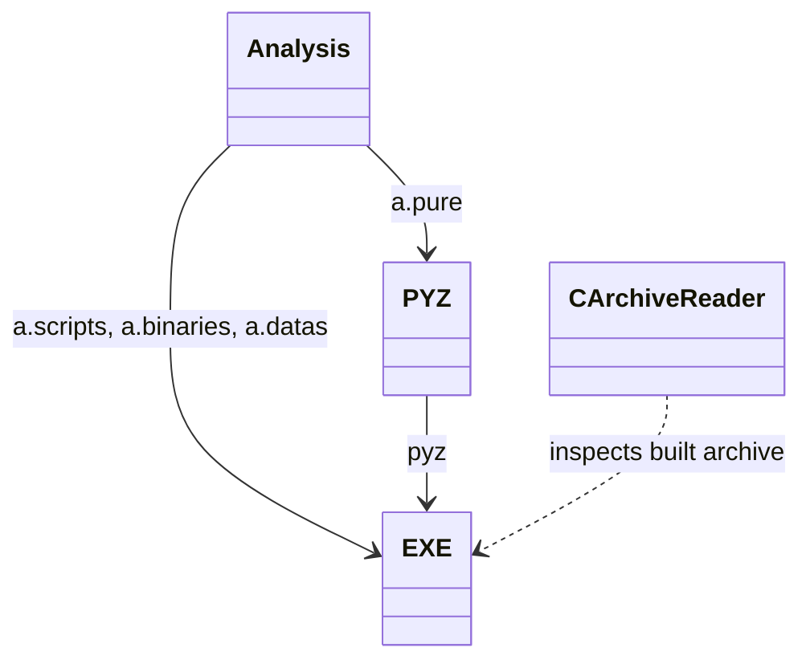

# Build Workflow Diagrams

## Class Diagram



[`Shortcut Studio.spec`](../../Shortcut%20Studio.spec) constructs PyInstaller's `Analysis`, `PYZ`, and `EXE` objects. [`verify_build.py`](../verify_build.py) uses `CArchiveReader` to inspect the resulting EXE. The PowerShell script itself defines no classes.

## Build Sequence

```mermaid
sequenceDiagram
    actor Developer
    participant Script as build.ps1
    participant Installer as PyInstaller
    participant Verifier as verify_build.py
    participant Archive as CArchiveReader
    Developer->>Script: .\scripts\build.ps1
    Script->>Script: Save PATH and select Windows/venv directories
    Script->>Installer: Build Shortcut Studio.spec
    Installer-->>Script: dist/Shortcut Studio.exe or error
    alt Build succeeds
        Script->>Verifier: Run with EXE path
        Verifier->>Archive: Inspect EXE entries
        Archive-->>Verifier: Archive table of contents
        Verifier-->>Script: Icon present; no bundled icuuc.dll
        Script-->>Developer: Built EXE path
    else Build or archive check fails
        Script-->>Developer: Error
    end
    Script->>Script: Restore PATH
```

The script performs the same verification after every build. The `finally` block restores the caller's `PATH` whether the build succeeds or fails.
