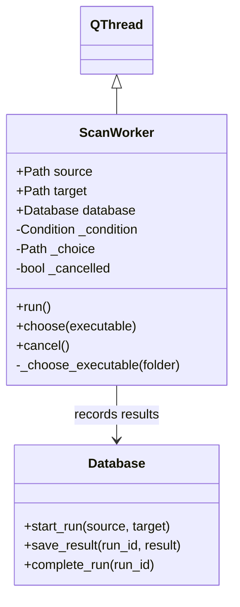
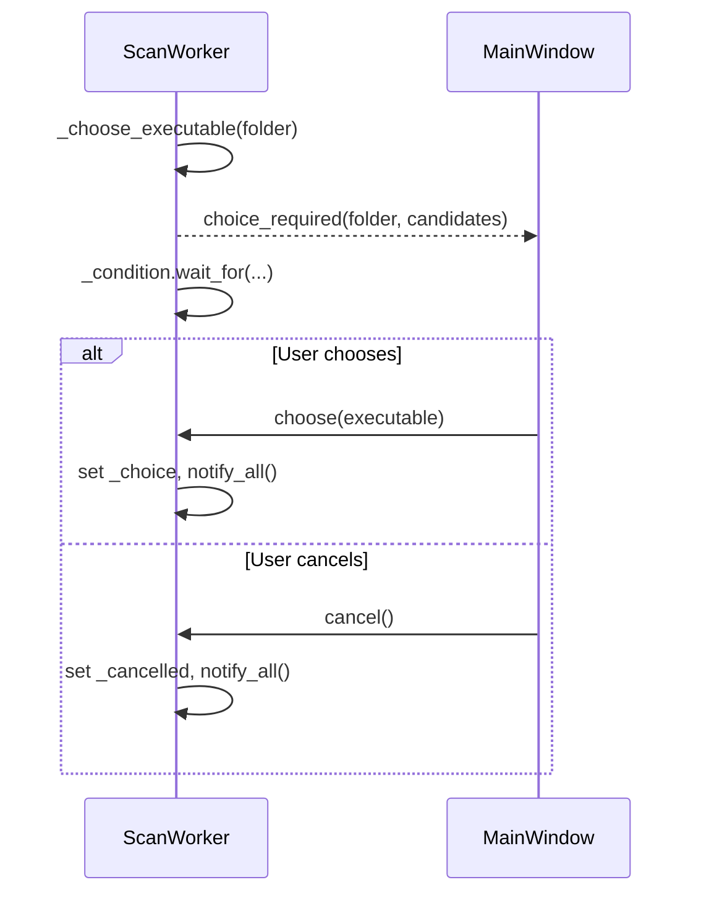

# Core Workflows

## Worker Types

[ScanWorker](../worker.py) runs on a QThread and receives its database. Its
condition variable coordinates choice and cancellation without blocking Qt's UI.

## Executable Choice

The condition's predicate checks choice or cancellation, so either user action
releases the wait. The remaining folder loop observes the cancellation flag.
