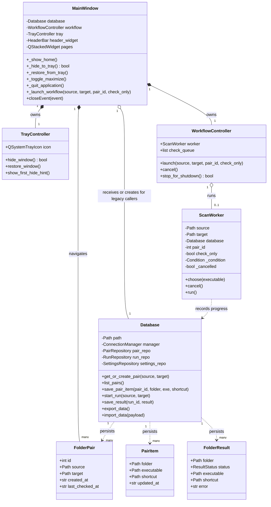
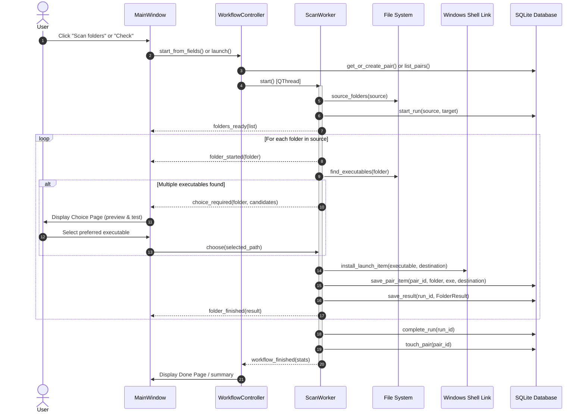
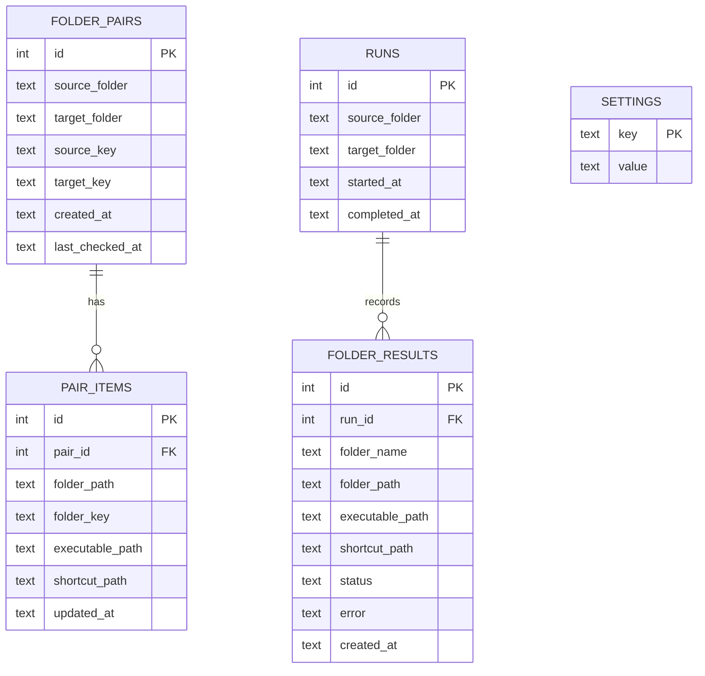
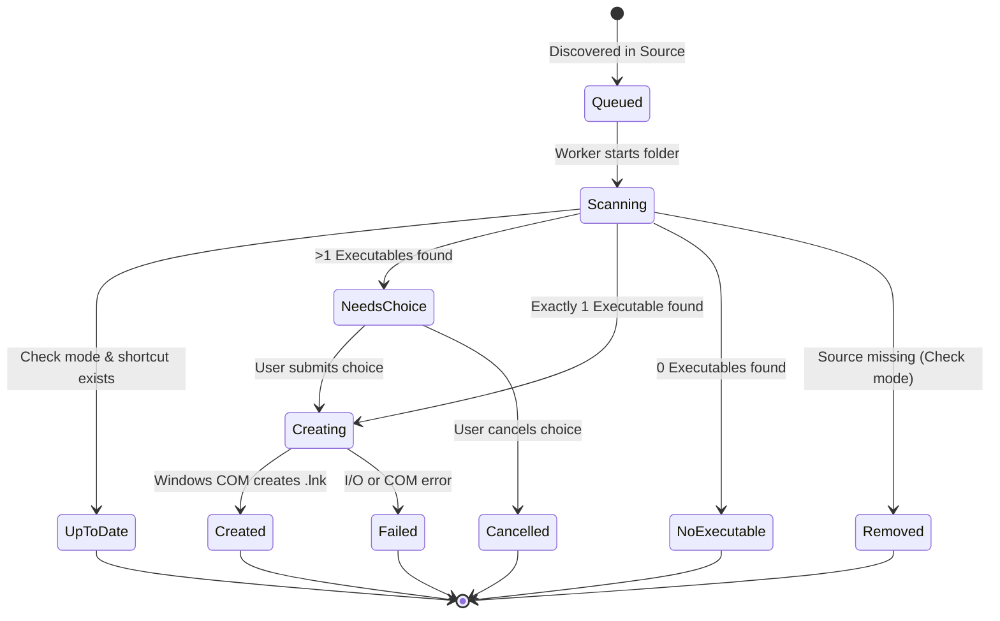
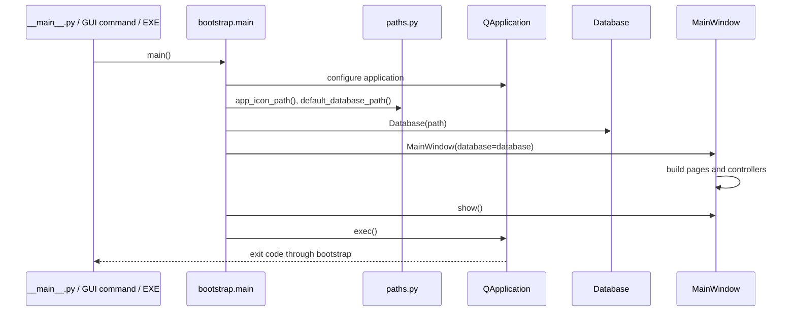

# Workflow & Architectural Diagrams

This document details the object relationships, execution sequences, data entities, and state transitions of **Shortcut Studio** using Mermaid diagrams.

---

## 1. Class Hierarchy & Architecture Diagram

The class diagram below depicts the primary types and their ownership boundaries across the presentation, background execution, and persistence layers.

### Explanation
- [`MainWindow`](../ui/window.py) hosts the pages and Qt window events. [`WorkflowController`](../ui/workflow.py) manages the optional active [`ScanWorker`](../core/worker.py) thread; [`TrayController`](../ui/tray.py) owns the tray icon and hide/restore behavior. `_hide_to_tray()` delegates to the tray controller and returns false when Windows has no notification area; `closeEvent()` then quits.
- The worker executes asynchronously and reports progress via Qt signals without locking the GUI.
- Library editing, executable selection, settings/backups, and resize interaction
  are delegated to dedicated UI controllers; their state and call sequences are
  documented in the [UI workflow guide](../ui/doc/workflow_diagram.md).
- [`FolderPair`](../models.py), [`PairItem`](../models.py), and [`FolderResult`](../models.py) are immutable value dataclasses that flow between storage, execution, and presentation.

---

## 2. Scan & Synchronization Sequence Flow

The sequence diagram illustrates how a scanning run processes folder items, interacts with the Windows COM API, and resolves candidate disambiguation when multiple executables are present.

### Explanation
- Steps 1–5: The user triggers a run; the pair record is resolved, and the worker initiates directory discovery.
- Steps 8–12: When more than one executable candidate exists in a subfolder, [`ScanWorker`](../core/worker.py) suspends its thread via `Condition.wait_for()`, prompting the user via [`choice_page.py`](../ui/pages/choice_page.py). Upon user confirmation, `ScanWorker.choose()` wakes the worker.
- Steps 13–16: The shortcut is created via [`install_launch_item()`](../core/shell_link.py) and results are committed to [`Database`](../storage/database.py).
- Steps 17–20: Completion metrics are collected and summarized on [`done_page.py`](../ui/pages/done_page.py).

---

## 3. Entity-Relationship Diagram (ERD)

The persistence model is implemented in SQLite, adhering to normalized relational schemas with cascading deletions.

### Explanation
- `FOLDER_PAIRS` and `PAIR_ITEMS`: Durable records of configured library pairs and their chosen application launch configurations. Managed via [`PairRepository`](../storage/repository.py).
- `RUNS` and `FOLDER_RESULTS`: Audit trail logging every execution, duration, and per-folder status outcome. Managed via [`RunRepository`](../storage/repository.py).
- `SETTINGS`: Key-value application configuration store (e.g. `open_target_after_completion`, `confirm_pair_deletion`). Managed via [`SettingsRepository`](../storage/repository.py).
- Uniqueness is composite: `(source_key, target_key)` for folder pairs and
  `(pair_id, folder_key)` for pair items; individual key columns are not unique.

---

## 4. Folder Result Lifecycle State Machine

Each folder processed by the worker transitions through the following discrete status lifecycle:

### Explanation
- Discovered folders start as `Queued` and enter `Scanning` when picked up by the worker loop.
- If in check mode and the destination already points to the valid executable, it reaches `UpToDate`.
- Ambiguous targets branch to `NeedsChoice` until the user confirms or cancels.
- Terminal outcome labels correspond to [`ResultStatus`](../models.py) values.
  The diagram's queued/scanning/choice states are conceptual UI states, not enum
  members. Cancellation stops the worker loop; it does not persist a CANCELLED
  result for every unprocessed folder.

## 5. Application Assembly

[`bootstrap.py`](../bootstrap.py) owns process startup. The window receives the
database and owns its UI controllers. Legacy UI entry points delegate to bootstrap.
