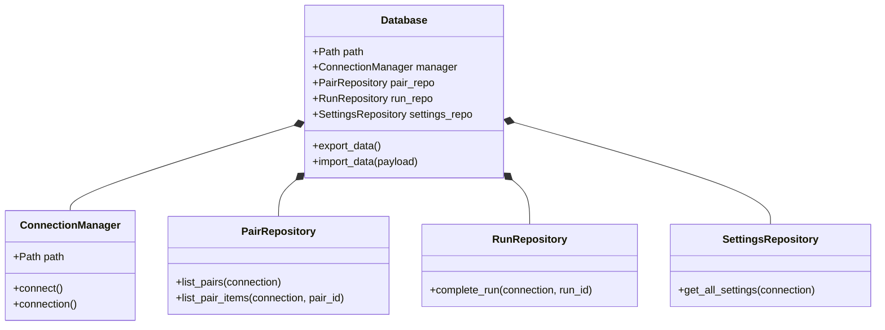
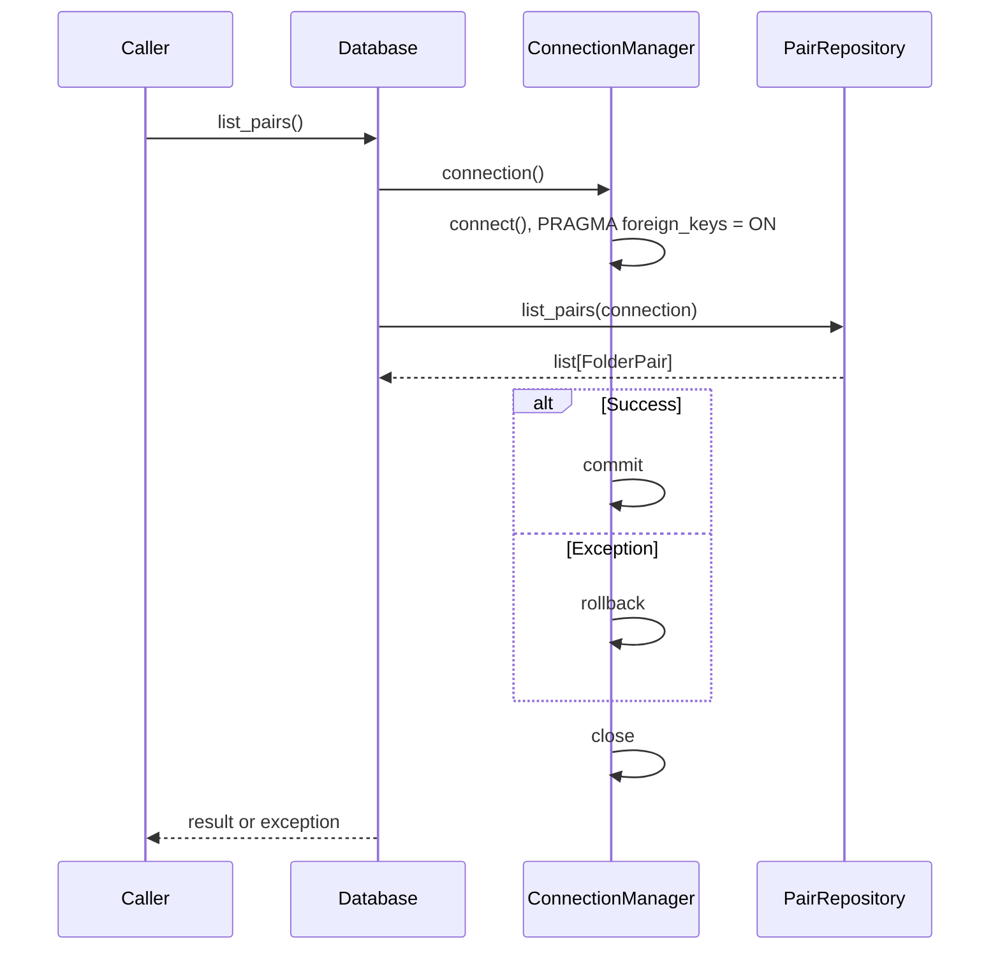

# Storage Workflows

## Class Relationships

The [Database facade](../database.py) owns repository objects. Connections are
short-lived resources managed by [ConnectionManager](../connection.py).

## Transaction Sequence

The context manager scopes commit/rollback and closure. Other facade operations
follow the same pattern; schema initialization also uses this connection manager.
