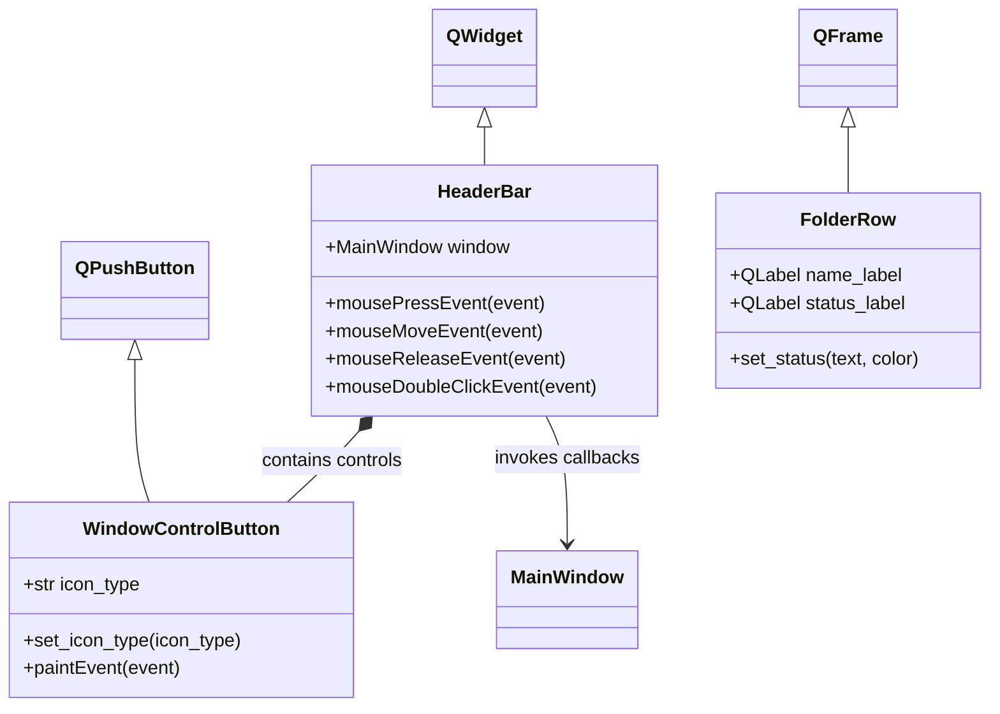

# Component Workflows

## Class Diagram

[HeaderBar](../header.py) owns its control widgets and forwards actions to the
window. [FolderRow](../folder_row.py) only renders folder status. Card and widget
modules expose factory functions rather than extra application classes.
