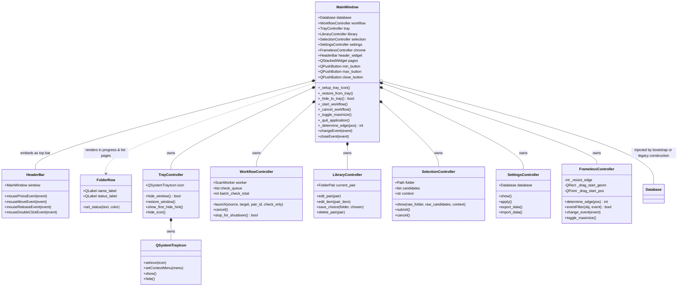
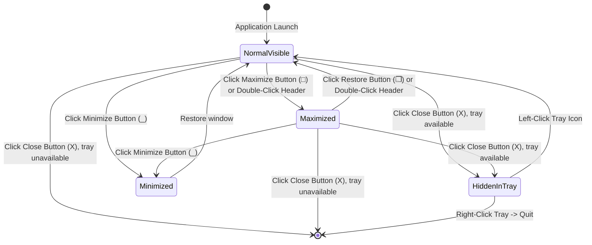
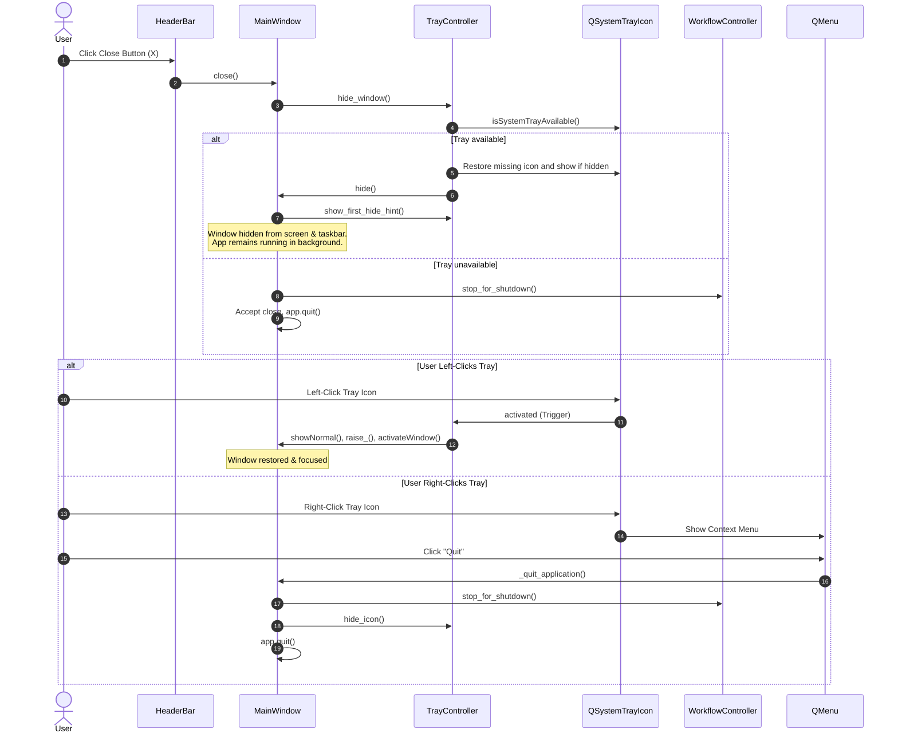

# UI Workflow & Architectural Diagrams

This document illustrates the visual hierarchy, window state transitions, and system tray interactions within the `shortcut_studio.ui` subpackage.

---

## 1. UI Class Diagram

The class diagram outlines the ownership boundaries between the window, custom framing chrome, tray controller, and workflow controller.



### Explanation
`MainWindow` hosts pages and Qt window events. `TrayController` owns the notification-area icon and determines whether the window can safely hide. `WorkflowController` owns worker lifetimes and batch state. Path resolution is implemented in `paths.app_icon_path()` and exposed through the legacy `_app_icon_path` alias; the normal minimize button uses `showMinimized()`. Bootstrap supplies the database in normal startup; both the window and workflow controller refer to that same instance.

LibraryController owns the edited pair; SelectionController owns candidate state;
SettingsController owns preference/backup actions; FramelessController owns resize
gestures. MainWindow keeps callback forwarding methods so page builders and worker
connections do not need to know every controller.

---

## 2. Window Lifecycle & Tray State Diagram



### Explanation
The window transitions between three primary presentation states:
1. **NormalVisible**: Frameless window with 12px rounded corners on all 4 sides.
2. **Maximized**: Borderless full-screen view with `border-radius: 0px`.
3. **Minimized**: Window remains present in the taskbar and Alt+Tab.
4. **HiddenInTray**: Hidden from screen and taskbar when the notification area exists; a hidden or missing tray icon is restored before hiding. With no tray, Close exits. The background loop is preserved via `QApplication.setQuitOnLastWindowClosed(False)`.

---

## 3. Close to Tray and Restore Sequence Diagram



### Explanation
The close action checks for a usable tray icon before hiding. Once hidden, a left-click restores the window; the right-click menu can shut down cleanly.

## 4. Edit Selection Sequence

```mermaid
sequenceDiagram
    participant UI as MainWindow callbacks
    participant Library as LibraryController
    participant Selection as SelectionController
    participant Link as shell_link
    participant DB as Database
    UI->>Library: edit_pair(pair), edit_item(pair_item)
    Library->>UI: _show_choice(folder, candidates, context="edit")
    UI->>Selection: show(folder, candidates, context)
    UI->>Selection: submit()
    Selection->>UI: _save_edited_choice(chosen)
    UI->>Library: save_choice(selection.folder, chosen)
    Library->>Link: install_launch_item(chosen, destination)
    alt Shortcut update succeeds
        Library->>DB: save_pair_item(...), touch_pair(...)
        Library->>Library: refresh_items()
        Library->>UI: display edit_detail_page
    else OSError
        Library->>UI: error dialog; retain choice page
    end
```

Only a successful shortcut write proceeds to updating the saved selection.
Workflow choices instead call `ScanWorker.choose()`; canceling an edit returns to
the detail page, while canceling a workflow delegates to WorkflowController.
