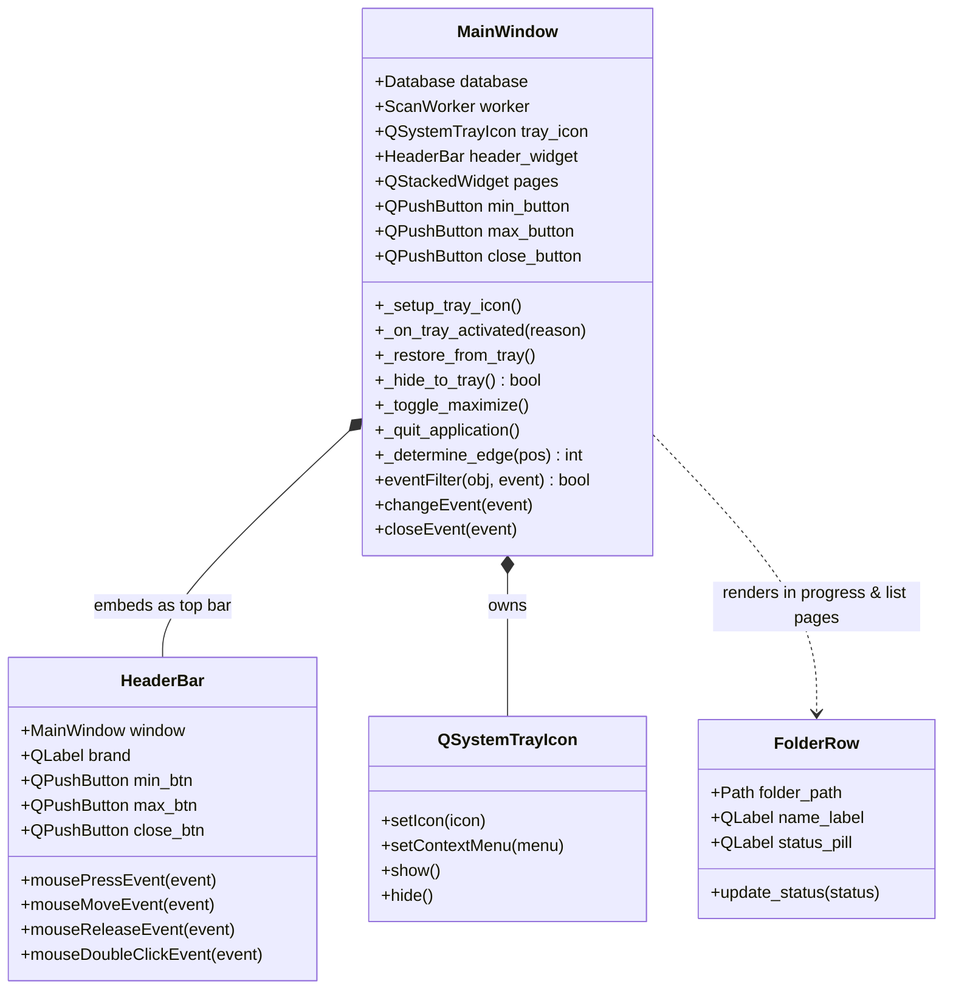
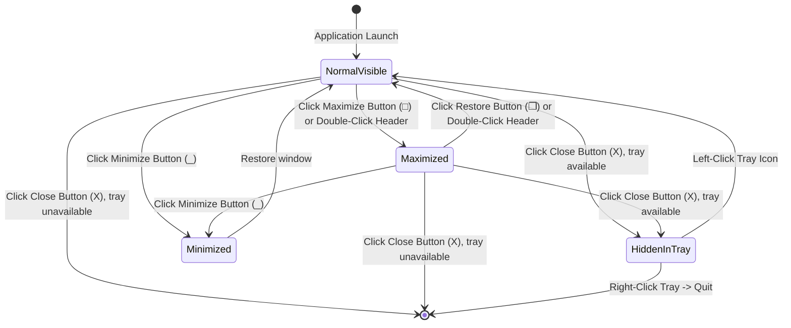
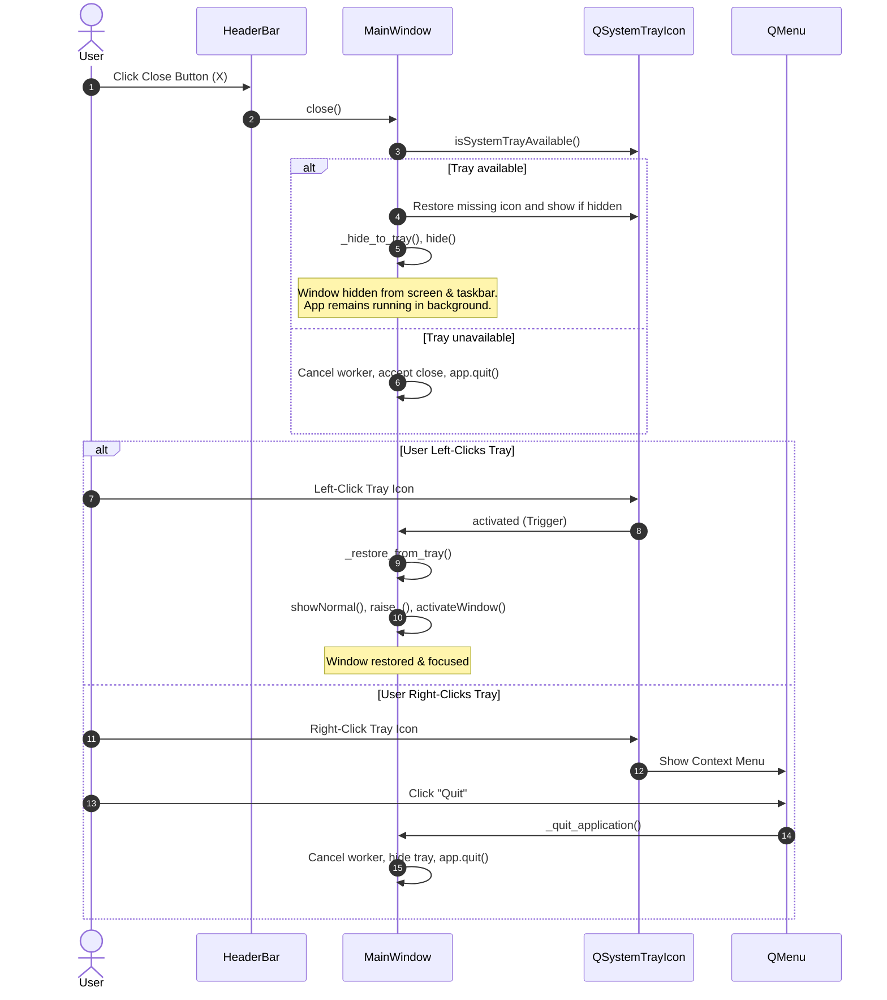

# UI Workflow & Architectural Diagrams

This document illustrates the visual hierarchy, window state transitions, and system tray interactions within the `shortcut_studio.ui` subpackage.

---

## 1. UI Class Diagram

The class diagram outlines the ownership hierarchy between the top-level orchestrator (`MainWindow`), custom framing chrome (`HeaderBar`), system tray integration (`QSystemTrayIcon`), and background workers.

### Explanation
`MainWindow` serves as the root controller. It inherits from `QMainWindow`, installs the `HeaderBar` at the top of its `#shell` layout, and instantiates `QSystemTrayIcon`. `_app_icon_path()` locates the bundled ICO for both window and tray icons. `_hide_to_tray()` returns whether the window could safely hide; the normal minimize button uses `showMinimized()`.

---

## 2. Window Lifecycle & Tray State Diagram

### Explanation
The window transitions between three primary presentation states:
1. **NormalVisible**: Frameless window with 12px rounded corners on all 4 sides.
2. **Maximized**: Borderless full-screen view with `border-radius: 0px`.
3. **Minimized**: Window remains present in the taskbar and Alt+Tab.
4. **HiddenInTray**: Hidden from screen and taskbar when the notification area exists; a hidden or missing tray icon is restored before hiding. With no tray, Close exits. The background loop is preserved via `QApplication.setQuitOnLastWindowClosed(False)`.

---

## 3. Close to Tray and Restore Sequence Diagram

### Explanation
The close action checks for a usable tray icon before hiding. Once hidden, a left-click restores the window; the right-click menu can shut down cleanly.
