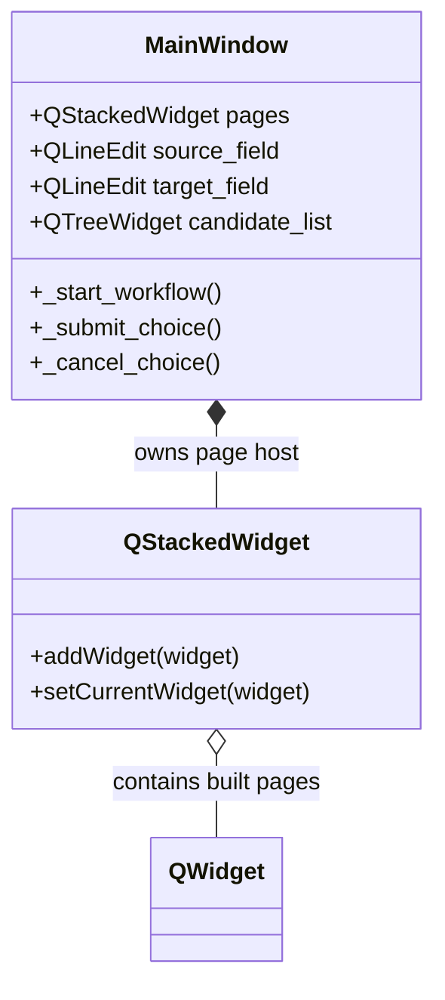
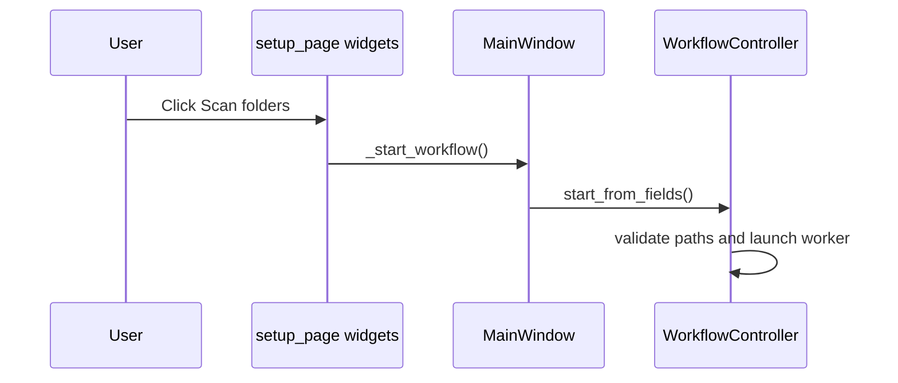

# Page Workflows

## Host Class Relationships

The package defines page-builder functions, not page classes. This diagram shows
the real Qt host types and MainWindow attributes assigned by the builders.

## Scan Action

[setup_page.py](../setup_page.py) binds the action; the window and workflow
controller perform validation and launch. Page construction has no scan side effects.
