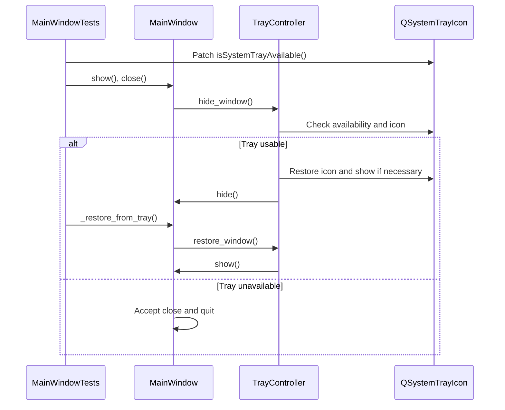

# Test Suite Workflow Diagrams

## Class Diagram

```mermaid
classDiagram
    class ScannerTests {
        +test_finds_unicode_executables_recursively()
        +test_lists_immediate_folders_only()
        +test_finds_shortcuts_whose_visible_name_ends_in_exe()
    }
    class ShortcutNameTests {
        +test_preserves_unicode_and_replaces_windows_invalid_characters()
        +test_handles_reserved_and_empty_names()
        +test_preserves_existing_windows_shortcut()
    }
    class DatabaseTests {
        +test_records_unicode_run_and_result()
        +test_saves_lists_and_deletes_folder_pair()
        +test_settings_and_export_import_round_trip()
    }
    class WorkerTests {
        +test_check_removes_shortcut_when_saved_source_folder_is_gone()
    }
    class MainWindowTests {
        +setUpClass()
        +test_system_tray_icon_and_hide_restore()
        +test_close_event_always_hides_to_tray()
        +test_close_exits_without_system_tray()
        +test_close_recovers_hidden_or_missing_tray_icon()
        +test_workflow_controller_releases_worker_after_completion()
        +test_workflow_controller_checks_saved_pairs_in_sequence()
        +test_packaged_icon_path_and_multisize_icon()
    }
```

These independent `unittest.TestCase` classes live in [`test_core.py`](../test_core.py). The diagram lists representative exact test methods; fixtures and additional tests remain in the same file.

## Close-to-Tray Test Sequence

The test patches only the tray availability report; [`MainWindow`](../../shortcut_studio/ui/window.py) and [`TrayController`](../../shortcut_studio/ui/tray.py) still execute their real close and restore logic. The packaged resource check is a separate test of `_app_icon_path()` and ICO size entries. The worker tests wait for Qt signal delivery and verify [`WorkflowController`](../../shortcut_studio/ui/workflow.py) releases the worker and runs batch checks in sequence.
